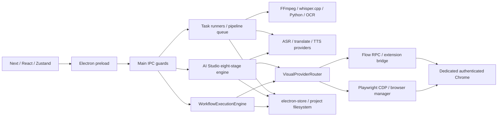

# VANHSUB — Full application audit, 2026-10-15

## Kết luận

**NOT READY để nghiệm thu production toàn bộ ứng dụng.** Đã sửa các lỗi được tái hiện về cách ly dữ liệu, cleanup tác vụ đang chạy, kiểm soát IPC, lưu checkpoint và trạng thái AI Studio. Bộ hồi quy offline và UI smoke có bằng chứng thực; chưa đủ bằng chứng cho Google Flow live, provider trả phí, chạy nhiều giờ, đóng app giữa job và Windows sạch. Không dùng kết quả mock để nghiệm thu provider.

Đọc cùng [risk register](CODEX_RISK_REGISTER.md), [test matrix](CODEX_TEST_MATRIX.md), [production readiness](CODEX_PRODUCTION_READINESS.md). Bằng chứng nằm tại [audit-evidence/2026-10-15](audit-evidence/2026-10-15/).

## 1. Phạm vi và baseline

- Yêu cầu: toàn ứng dụng, gồm AI Studio và Workflow AI, audit rồi sửa lỗi xác nhận, không rewrite, không xóa dữ liệu người dùng.
- Source được kiểm tra: local `main` của `D:\DEAN\DEAN\VANHSUB`, commit `df9d768`; thực hiện trong worktree riêng, branch `codex/full-audit-20261015`.
- GitHub `origin/main` tại thời điểm fetch là `899088f`. Hai lịch sử phân kỳ **27 commit phía remote / 5 phía local**, không phải local đã chứa toàn bộ bản sửa trước. Không force push, reset hay tự thay thế source chính. Việc hợp nhất hai lịch sử cần review riêng; báo cáo này không chứng nhận các thay đổi trên nhánh khác.
- Đã đọc `VANHSUB_CODEX_HANDOFF.md` tại root. Tài liệu cũ chỉ dùng tìm hướng, không dùng làm bằng chứng PASS.
- Giữ nguyên các script/temp/HAR chưa commit trong checkout D. Không đọc giá trị cookie, token hay API key của người dùng.
- Môi trường: Windows 10.0.26200, Node 24.19.0, Electron 43.4.1, Next 16.3.2, React 19.2.8, TypeScript 5.9.3. `node_modules` là junction sang checkout D, gây giới hạn build qua hai ổ đĩa.

## 2. Kiến trúc và dependency map

Runtime entry points là `main/main.ts`, `main/preload.ts`, `main/workflow/ipc.ts`, `main/ai-studio/ipc.ts`. Workflow IPC dùng `WorkflowExecutionEngine`, không được mặc định `WorkflowGraphEngine` là engine chính. `main/ai-studio/pipelineEngine.ts` là entry/re-export; engine thực ở `AiStudioPipelineEngine.ts`. Các file không có inbound import trực tiếp có thể là barrel, Python sidecar, extension hoặc test tool; chưa có bằng chứng để xóa.

Điểm tốt: phân tách main/renderer; FFmpeg có kiểm tra stream/duration; routing visual có idempotency và phân loại unusual activity; TTS phụ đề có giới hạn tempo; lưu media có version/provenance; dự án có schema trạng thái.

Nợ kỹ thuật: engine và IPC lớn, state mutable chia sẻ, cấu hình global đọc lại khi resume, hai họ workflow engine; renderer nhập một số pure helper từ main; nhiều đường browser/bridge/CDP cạnh tranh. Dependency scan phát hiện các nhóm cycle quanh kinetic/ASS, Flow selector/fallback, Veo/Flow state, ChatGPT collector/session và engine/IPC/CapCut; cần phân biệt type-only với runtime trước khi refactor. Không xóa dependency chỉ vì không thấy JS import: `nodejs-whisper` còn được dùng để build/chạy binary.

## 3. Những lỗi đã sửa và bằng chứng

| ID | Mức | Root cause và thay đổi | Bằng chứng |
|---|---|---|---|
| F01 | P0 | Thư mục project chỉ theo basename nên hai video trùng tên dùng chung output. Thêm identity theo task; chặn projectDir cũ bị nhiều task nhận; giữ file cũ. `main/utils/projectFolder.ts` | `test_full_audit_data_integrity`, baseline probe |
| F02 | P0 | Workflow cleanup được gọi với active IDs rỗng; watchdog/cancel có thể kết thúc wrapper khi provider vẫn chạy. Storage giữ reference-count lease cho actual node promise; cleanup không xóa workspace đang sử dụng. `WorkflowStorageManager.ts`, `executionEngine.ts` | Deferred node, duplicate run, cancel, cleanup thật trên FS |
| F03 | P0 | Hai episode cùng project dùng chung workspace/checkpoint/voice. Tạo workspace/media riêng cho session mới, pin đường dẫn, kiểm tra owner và ID khi load; checkpoint lỗi phải báo lỗi. `sessionPersistence.ts`, engine | Hai episode, restart, wrong-ID, path traversal, lỗi ghi thật |
| F04 | P0 | Atomic write fallback unlink bản tốt rồi copy; khi cả rename/copy lỗi có thể mất dữ liệu. Bỏ unlink/copy fallback; rename lỗi giữ nguyên đích. `storage/AiStudioDiskStorageManager.ts:183` | Inject EPERM và copy failure; bản cũ nguyên vẹn |
| F05 | P1 | Main/workflow/AI IPC tin mọi sender; điều hướng app chưa bị chặn. Guard đúng WebContents + mainFrame + origin; context isolation/node integration/web security khai báo rõ. `main/security/*`, các IPC entry | Security negative cases và preload IPC thật trong UI |
| F06 | P1 | Mở Chrome qua chuỗi shell chứa URL; xóa model và app protocol thiếu containment. URL Flow allowlist, spawn argv shell:false, model-name validation, containment bundled path. `main/main.ts:1127,1786`, `rendererTrust.ts` | URL/userinfo/scheme/host và traversal negative cases |
| F07 | P1 | WebSocket loopback không kiểm tra Origin hay payload bound. Chỉ nhận Chrome-extension Origin, maxPayload 32 MiB. `bridgeTransport.ts` | Handshake thật: website/no-Origin bị từ chối; extension-shaped Origin được nhận |
| F08 | P1 | Các runner riêng và pipeline có thể chạy cùng task; promise nền bị bỏ qua. Shared task lease, observe rejection, chặn edit/delete khi đang chạy, giữ lease đến settle. `taskLease.ts`, `main/main.ts:414` | Deferred promise, error reporter, 1000 lease cycles; chưa phải stress FFmpeg thực |
| F09 | P1 | ASR/dịch xóa TTS và mất pointers trước khi provider thành công; TTS rerun ghi lại folder cũ. Hoãn invalidation đến thành công, giữ artifact cũ, đường dẫn ASR/dịch/merged audio mới, TTS run folder UUID | Ca ASR/translation failure giữ audio/file/pointers; provider success thật chưa chạy |
| F10 | P1 | Approve tin currentStage từ caller; cancel giải phóng controller/lease quá sớm; resume stage 0. Validate gate/stage, session lease dùng chung cho pipeline và sửa media/script, release theo actual promise | `test_full_audit_session_jobs` |
| F11 | P1 | Chấm script bằng điểm cố định; refine có template khảo cổ tiếng Tây Ban Nha không theo chủ đề. Gọi provider và validate D1–D10/full JSON; refine giữ IDs/order và không nhận file pointers từ model | Mock provider contract tests; chưa nghiệm thu chất lượng LLM live |
| F12 | P1 | Sửa lời thoại vẫn giữ audio/scenes/video cũ. Validate lines, lưu history, clear pointers downstream, đưa về gate script, không xóa file | `test_full_audit_script_artifacts` |
| F13 | P2 | Phiên serialize running vẫn hiện chạy sau restart dù không có job. Load chuyển sang failed/recoverable trong memory; không tự ghi vào legacy directory xung đột | Restart fixture trong episode suite |
| F14 | P1 | TTS Studio thay duration rỗng/0 bằng 5 giây. Reject duration không finite/dương | Mock ffprobe: 0, âm, missing, NaN và positive |
| F15 | P1 | Logger có thể lưu/phát thông tin nhạy cảm thô tới mọi window. Redact structured secret keys, Bearer/query tokens và text phổ biến; console/file/IPC dùng cùng formatter; chỉ gửi log cho app renderer tin cậy | Synthetic credential fixtures; không cam kết phát hiện mọi chuỗi bí mật không có nhãn |
| F16 | P1 | Extension tạo project mới có thể điều hướng tab nền thủ công vì chỉ bảo vệ tab active. `ensure_project(createNew)` bỏ chọn tab cũ; luôn tạo tab riêng, khác project cũng bảo vệ unowned background tab; manifest1.0.7 | VM regression active/background PASS; bản sửa chưa nạp vào extension đang chạy1.0.6 |

Không có file media sản xuất bị di chuyển/xóa trong audit. Bản vá cách ly session mới không tự migrate legacy folder đang xung đột; thao tác ghi bị chặn để người dùng giữ dữ liệu.

## 4. Review chức năng thực có trong app

| Chức năng / entry | Luồng input → output / storage | Cancel, recovery, kết quả |
|---|---|---|
| Import/download (`downloader:*`, tasks) | Local path/URL → inspect/download → TaskStore/project | Có cancel download; source review. Live download/SSRF/timeout mọi host **NOT TESTED** |
| ASR (`TaskRunner`, unified ASR) | Video → WAV16k → whisper.cpp/faster-whisper/provider → SRT | Có cancel; failure giữ đầu ra trước. Nhận dạng nhiều ngôn ngữ/Python/model tải mới **NOT TESTED** |
| OCR/hybrid (`OcrRunner`, `HybridRunner`) | Video/ROI → OCR sidecar/frames → SRT kết hợp ASR | Parser/normalizer offline PASS; full video OCR/Paddle/cancel worker **NOT TESTED** |
| Dịch (`TranslateRunner`, translator) | SRT strict → segmented Gemini translation → SRT/timeline | Mock response/error/thứ tự/timestamp PASS; network overload thật và semantic fidelity **NOT TESTED** |
| Editor/subtitle | Task SRT → parse/edit/write → project | IPC writes bị chặn khi active. Editor thao tác dài/undo/overlap trên file thật **NOT TESTED** |
| TTS phụ đề (`ttsEngine`, `ttsTiming`, runner) | SRT → sentence groups/voice map → đo audio → timing adaptation → merge | Có tự thích nghi slot, thử rate/shorten, giới hạn tempo mặc định1.35 và báo conflict. Unit policy PASS; không chứng nhận nghe tự nhiên hoặc không mất nghĩa; full Edge/TikTok/VietTTS **NOT TESTED** |
| Dubbing/stems/export | Video + SRT/audio/options → FFmpeg → rendered output | Có cancel/error checks; FFmpeg concat/guard test PASS. Hardsub fonts, speed/mix/softsub và stem separation UI E2E **NOT TESTED** |
| AI Studio 8 bước | Topic/project → idea/script/voice/alignment/storyboard/media/video/metadata → per-session storage | Storage/gates/races/contracts PASS offline. Full provider pipeline và new short20–30s mode live **BLOCKED/NOT TESTED** |
| Visual/image/T2V/I2V/keyframe | Prompt + Flow project/keyframe/mediaId → router/RPC/extension/CDP → asset index | Code has provenance/delta/state machine. Full real generation, duplicate suppression across restart và downloaded-output provenance **BLOCKED** |
| Workflow AI | Graph nodes/edges → executionEngine → FS outputs/events | Cleanup/cancel/lease real local integration PASS; full DAG/provider/UI authoring **NOT TESTED** |
| Project/settings | electron-store + session/catalog + project index | Restart settings UI PASS; episode identity PASS; global/project/session config snapshot còn nợ R03 |
| ChatGPT/Gemini web, CapCut | Browser session/provider replies → script; project assets → draft | Source review only; không gọi provider có phí. Conversation isolation, import CapCut thật **NOT TESTED** |

UI smoke đã click AI Studio, Workflow AI, Phụ đề, Lồng tiếng, Xuất video, Cài đặt; có ảnh settings, không thấy overlap tại cửa sổ mặc định được chụp. Chưa đủ để kết luận mọi nút hữu ích hoặc mọi dialog/resolution đạt QA. HOT/MỚI và hai entry Chrome/Sảnh Electron có thể gây nhầm lựa chọn; chúng đang trỏ các cơ chế khác nhau, chưa đủ bằng chứng coi là nút thừa để xóa. Các stub message trong IPC fallback không chứng minh feature vô dụng nếu delegate thật đã nối.

## 5. Export duration và đồng bộ

`test_video_processor_concat.ts` tạo ba video khoảng4s với timebase khác nhau, chạy concat/normalize thật, đo output **12.00s** và reject missing/empty/corrupt/audio-only. Không tái hiện 58.67s trên fixture này. `test_timeline_export_duration_guard.ts` tạo media mới thay vì cần file cũ: mismatch timeline bị chặn; freeze-last-frame render **19.000s** theo lịch7+6+6. Đây là bằng chứng cho hai đường kiểm tra cụ thể, chưa phải nghiệm thu tất cả codec/FPS/VFR/media do Flow sinh.

AI Studio TTS chủ yếu dựng timeline theo audio sinh ra; không phải cùng bài toán ép từng sub slot của TTS phụ đề. Alignment syllabic/ước lượng không đồng nghĩa forced alignment đạt chất lượng nghe thực. Chưa nghe kiểm tra một pipeline live nên không khẳng định không trùng/mất câu.

## 6. Bảo mật và dependency

IPC/navigation/command/path/log/bridge đã harden như F05–F07/F15. **Origin extension không phải xác thực extension**: local client có thể giả Origin; còn cần pairing/identity policy. CDP là quyền điều khiển browser và phải gắn với profile test riêng.

`npm audit --omit=dev --json`: **9 high / 0 critical**, 216 prod dependencies (metadata total666). Có axios, fast-uri, js-yaml, source-map-js và chain braces/micromatch/fast-glob/shelljs/nodejs-whisper. Đây là severity scanner, chưa chứng minh toàn bộ advisory reachable trong app. Không chạy audit fix hoặc cập nhật hàng loạt; npm có đề xuất downgrade whisper không nên áp dụng mù. Xem JSON để lấy advisory/range/fix chính xác.

Rủi ro còn lại: settings DPAPI có plaintext fallback; AI config headless dùng base64 có thể đảo ngược; media scheme cho phép path local rộng và chưa có capability manifest; chưa thấy CSP rõ ràng; IPC payload validation chưa đầy đủ theo từng channel. Không đọc secret thật để chứng minh các nhánh này.

## 7. Build/runtime/resource

- Typecheck main và renderer PASS. 15 suite offline PASS, có negative cases và fixture FS/FFmpeg thực, chi tiết trong test matrix.
- `npm run build` thật: whisper native compile PASS, renderer Turbopack FAIL trong worktree do junction ngoài filesystem root. Webpack tại worktree cũng vướng resolve liên ổ C/D. Đây là giới hạn môi trường, vẫn là build chuẩn chưa PASS end-to-end.
- Copy source/config vào thư mục tạm riêng cùng ổ D, junction dependencies hiện có; SHA256 manifest lưu bằng chứng. Next static Webpack build PASS; main/preload Nextron Webpack PASS với5 optional-dependency warnings. Không sửa checkout nguồn chính để vượt build.
- Electron UI dùng profile riêng, bridge tắt, không generation. Run60s cuối: startup1035ms (một mẫu warm), 4processes; tổng working set609.12→502.76MiB, CPU sample tổng0–0.19%. Không đo disk throughput hay peak export RAM. Đây là idle smoke, không phải multi-hour soak hay proof không leak.
- Đóng/mở lại giữ settings; chưa kill app giữa paid/network/FFmpeg job. Checkpoint recovery test dùng engine/store thật và provider stub, không thay thế crash test OS thực.
- Packaging qua junction ban đầu exit0 nhưng executable launch timeout60s; archive thiếu `conf`, platform FFmpeg/FFprobe. Lần kế tiếp `npm ci --ignore-scripts --omit=dev` theo lockfile vào folder riêng, chỉ định electronVersion43.4.1 cho builder và copy whisper binary đã compile vào đúng workspace: package exit0, archive đủ các module/binary kiểm tra; FFmpeg/FFprobe `-version`, whisper `--help` đều exit0. Executable thật qua6routes+restart PASS, startup1302ms; đây là cùng host, chưa Windows sạch hay installer. Authenticode status **NotSigned**. Xem `runtime-packaged.json`, `package-module-presence-clean.json`; giữ lần fail ở `runtime-packaged-junction-failure.json`.

## 8. Chất lượng test và giới hạn

Tên `test_live_aistudio_visual_pipeline.ts` thực tế inject mock RPC; `test_real_browser_hardening_and_safeguards.ts` có case closed-port được stub. Không tính chúng là live pass. Runner cũ suy count=1 khi không parse được output và không có child timeout; audit runner dùng allowlist offline, timeout120s/suite, lưu exit code, không suy diễn số assertion.

Hai suite media trước đây âm thầm skip positive/timeout nếu thiếu fixture cũ. Đã đổi sang tự tạo ảnh/video trong temp, media validator chạy10case; timeline guard render thật. Không đổi tên test để che mức coverage. Một lần broad runner bị auto-review chặn vì có tên live/production; đã thu hẹp allowlist và chạy offline an toàn.

Google Flow: probe cuối tự mở bridge loopback riêng khi hai cổng đang rảnh, extension1.0.6 kết nối/handshake thật thành công qua Origin guard; CDP9224 vẫn không có. Probe chỉ chờ kết nối, không gửi lệnh tab/auth/generation. Phát hiện F16 trong ownership nên không dùng extension cũ tạo media. Người dùng sau đó chọn **“Tạm ghi nhận live test chưa hoàn tất”**. **Generation thực do audit này gửi:0; credits:không phát sinh từ audit.** Không cố lấy cookie, tự tạo phiên đăng nhập, bypass CAPTCHA hay can thiệp tab thủ công. Runner live cũ còn `.first()`/gallery fallback và chọn page có sẵn; cần kiểm tra ownership/correlation trước khi dùng.

## 9. Việc ưu tiên tiếp theo

1. Nghiệm thu executable/installer trên Windows sạch và sửa mọi dependency/path issue tìm thấy.
2. Nối phiên test Flow riêng; test giới hạn một ảnh→I2V, một T2V, tải/validate/provenance, hủy/disconnect và export nhiều cảnh; dừng nếu challenge.
3. Pin config theo owner/session, thiết kế revision output đầy đủ; test đổi project/config lúc paused, tránh gọi nhầm provider hoặc dùng artifact cũ.
4. Kiểm thử app quit giữa job, child cleanup và soak nhiều giờ; chạy project lớn để đo thực.
5. Vá dependency theo từng advisory reachable, test native/provider compatibility; harden secret storage/pairing/CSP bằng migration có kiểm thử.
